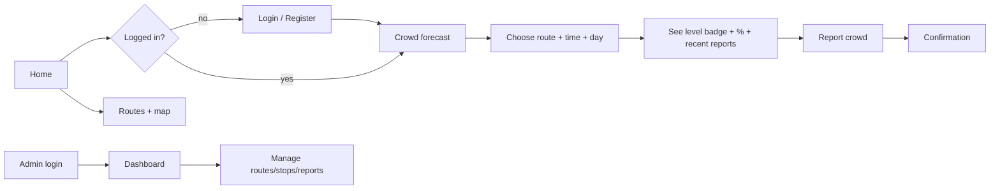

# UX design (Modules 4 & 5)

> **Honesty note:** no real user interviews or usability sessions were run while building this scaffold. Personas, journey and test plan below are **hypotheses written from the problem statement** – the team (Member 5 leads) must run the real interviews/tests and replace the "to be validated" items with evidence.

## Module 4 – Design Thinking
### 1. Empathize
Plan: interview 5–8 Mysuru commuters (students, office-goers, seniors) + observe at a bus stand; short Google Form (peak hours, how they judge crowding today, what they'd trust). Admin side: talk to a transport staff member if possible. *Status: planned, not yet done.*

### 2. Define – problem identification
"A passenger waiting at a Mysuru stop needs to know **how full the next bus on their route will probably be**, because boarding a packed bus wastes time and is uncomfortable/unsafe; today there is no information." Admin: "needs to see where and when demand peaks to plan buses."

### Personas (hypothetical)
**Passenger – Ananya, 19, engineering student.** Takes a city bus to college daily 8:30 and home 5:30; phone-first; low patience for registration friction. *Goals:* pick the least crowded departure; stand-or-sit expectations. *Pain:* arrives, bus is overcrowded, late for class. *Needs:* 2-tap forecast, clear colour+text level, report in under 10 s.

**Administrator – Mr. Ramesh, 42, depot operations assistant.** Desktop user, moderately tech-comfortable. *Goals:* see which routes/hours are crowded, keep route/stop data correct, remove bogus reports. *Pain:* scattered manual records. *Needs:* one dashboard, simple tables, safe delete.

### User journey (Ananya)
| Stage | Action | Thought | Emotion | Opportunity |
|---|---|---|---|---|
| Plan | Opens SmartBus at home | "Which bus at 8:30?" | Anxious | Fast route+time picker |
| Check | Selects SB-04, 08:30 | "Is it packed?" | Hopeful | Clear Low…Overcrowded badge |
| Decide | Sees High 78 % → leaves earlier | "Try 08:00" | In control | Easy re-check |
| Ride | Boards, bus is crowded | "Others should know" | Helpful | One-tap report |
| After | Sees her report listed | "Useful" | Satisfied | Show recent reports |

### 3. Ideate
Ideas considered: live GPS occupancy (rejected – needs hardware/APIs), QR-on-bus check-in (future), **crowd forecast + passenger reports (chosen – feasible, no privileged access)**, push alerts (future). Decision: simple 4-level scale; colour + symbol + text.

### 4. Prototype
Low-fi wireframes (`wireframes/*.svg`, generated by `make_wireframes.py`) → hi-fi Figma file following `figma-spec.md`.

### 5. Test (plan)
5 users × 4 tasks: (1) find crowd for SB-01 at 09:00 Monday, (2) submit a report, (3) find stops of a route on the map, (4) *admin*: add a stop. Measure task success, time, errors, SUS score; iterate and record findings in `docs/testing/usability-test-results.md` (**to be created after real sessions**).

## UI requirements
Mobile-first, 1-column on phones; text ≥16 px; touch targets ≥44 px; level never shown by colour alone; inline validation messages; loading and error states; keyboard focus rings; map has a list alternative; footer states data is illustrative.

## Module 5 – Factors influencing UX
**Seven UX factors (Morville's honeycomb) → how SmartBus applies them**
| Factor | Application |
|---|---|
| Useful | Solves the "how crowded?" question |
| Usable | 3-step flow, minimal fields |
| Desirable | Clean branding, calm blue, clear badges |
| Findable | Top nav; routes searchable by list/map |
| Accessible | Labels, contrast, symbols, keyboard, aria-live results |
| Credible | Shows data source (simulated), timestamp, no accuracy claims |
| Valuable | Saves time; admin analytics support planning |

**Five usability characteristics (effective, efficient, engaging, error-tolerant, easy to learn)**
Effective – forecast returns a definite category; Efficient – 2-3 taps; Engaging – instant visual feedback, thank-you message; Error-tolerant – validation, undo-able reports (admin delete), friendly errors; Easy to learn – single-purpose screens, plain words.

**Interaction design – five dimensions (1D words, 2D visuals, 3D physical/space, 4D time, 5D behaviour)**
1D: short labels ("Check crowd level"). 2D: map, badges, charts. 3D: thumb-reachable bottom-aligned buttons on phones, 44 px targets. 4D: loading states, time-of-day input, previous-report timestamps. 5D: system response – confirmation messages, errors, forecast changes after recent reports.

## User flows

